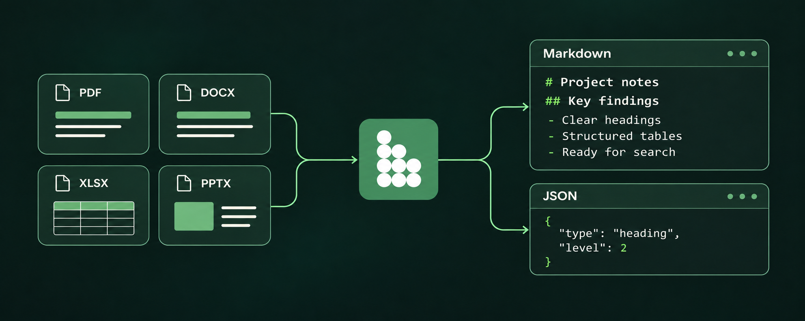

<p align="center">
  <a href="https://bulkgrid.com">
    
  </a>
</p>

<h1 align="center">BulkParse</h1>

<p align="center"><strong>Documents in. AI-ready content out.</strong></p>
<p align="center">Turn PDFs, spreadsheets, slides and documents into Markdown and structured JSON.<br>Native Rust speed. Your infrastructure. Your rules.</p>

<p align="center">
  <a href="https://github.com/bulkgrid/bulkgrid"></a>
  <a href="LICENSE"></a>
</p>

<p align="center">
  <a href="#quick-start">Quick start</a> ·
  <a href="#supported-formats">Formats</a> ·
  <a href="#benchmarks">Benchmarks</a> ·
  <a href="#use-your-language">APIs</a> ·
  <a href="#documentation">Documentation</a>
</p>



**Build the next step. BulkParse handles the document conversion.** Give your search engine, RAG pipeline or AI agent readable Markdown and structured records from the files your users already have. Convert PDFs, Word documents, spreadsheets, presentations and ebooks through one API, with headings, tables and source references your application can work with.

Built in **Rust** by [Bulkgrid](https://bulkgrid.com). Use it from **Node.js, Python, Rust or the browser**. Run the native conversion core on your own infrastructure without an API key, model download or external parsing service. **Open source. MIT licensed. Yours to build on.**

> **200 PDFs in 0.440 seconds.** BulkParse used **40% less conversion time than the next-fastest tested configuration** in our same-machine PDF development benchmark, with OCR off and startup excluded. Compare eight engines across speed, extraction scores and memory. [See the full results and trade-offs ↓](#benchmarks)

## Why BulkParse?

- ⚡ **Spend less time parsing.** Native Rust conversion keeps document ingestion moving. Our 200-PDF benchmark finished in under half a second, with OCR off and startup excluded. The configurations and raw results are available to reproduce it.
- 📚 **Bring your mix of files.** PDFs, modern and legacy Office documents, OpenDocument, EPUB, RTF, CSV and more feed into a shared document model. Build one integration for the formats your users send.
- 🧩 **Keep the structure that makes content useful.** Extract headings, lists, rich text and supported tables, including merged cells. Use Markdown for search and prompts, and structured JSON when your application needs rows, cells and document blocks.
- 🔒 **Run where your application runs.** Embed the conversion engine in server pipelines, desktop applications or browser experiences with WebAssembly. You choose where document bytes are processed; the native conversion core needs no external parsing service or API key.
- 🪶 **Choose an efficient ingestion path.** A native conversion core keeps the deployment focused on document processing. Compare measured memory alongside speed in our [benchmark results](#benchmarks); the best fit depends on your workload.
- 🔍 **Know which PDF pages need OCR.** Built-in inspection identifies native text, blank pages and OCR candidates before you invoke a separately provisioned OCR backend. Page-level reasons help your pipeline choose its next step.
- 📖 **Unlock scanned PDFs with integrated OCR.** Extract text from scanned pages in your deployment and bring it into the same document output. Enable the OCR build and provision the models once; no hosted OCR API is required. [OCR setup and capabilities](#integrated-ocr).
- 🔌 **Fit into the stack you already use.** Node.js, Python, Rust and WebAssembly share the same conversion core. Node conversion is asynchronous; Python releases the GIL while native conversion runs.
- 🧭 **Make extraction decisions with evidence.** Coverage, diagnostics and source references travel with the result. Accept useful content, route partial results for more processing, or flag a document for review.

**From file uploads to searchable knowledge.** Use BulkParse to prepare documents for retrieval, give agents readable source material, normalize an Office archive, or embed document conversion in your application. [Build your first conversion ↓](#quick-start)

## Quick start

> **Developer preview:** build from source today. Package-registry releases and prebuilt binaries are not available yet. See [current scope](#current-scope) for extraction and platform coverage.

Maintainers: [release pipelines and registry setup](docs/releases.md) cover npm, PyPI, crates.io, WebAssembly and CLI downloads.

From a source checkout, with Rust installed:

```sh
cargo build --release -p bulkparse-cli --locked

# Convert a document to Markdown
./target/release/bulkparse parse fixtures/hello.docx

# Export structured JSON
./target/release/bulkparse parse fixtures/table.csv --to json

# Inspect a PDF and its OCR-routing recommendations
./target/release/bulkparse inspect fixtures/native-and-empty.pdf
```

Convert a directory with `./target/release/bulkparse batch ./documents --output ./parsed`. Batch processing is sequential, writes per-file results, and continues after individual errors. Choose an output directory outside the input directory; existing output files are not overwritten.

CLI exit codes: **`0` complete · `2` partial · `1` failure**. Partial results can contain useful extracted content; inspect their diagnostics. Native PDF conversion currently reports partial coverage by design.

Run `./target/release/bulkparse capabilities` for build-specific format support and `./target/release/bulkparse schema` for the structured output schema.

### Embedded images

Keep supported Office and EPUB images as assets in structured output, or save
them alongside Markdown for applications and image-capable agents:

```sh
bulkparse parse document.docx -o document.md --export-images
```

Image retention is bounded and can be disabled with `--no-images` or
`extract_images: false`. Embedded images render as alt text in Markdown; exporting
assets does not add image links or an asset section. Structured output retains
resolved image references and the export summary lists saved files. PDF image
export is not supported. Images are not interpreted automatically. See
[image support and limits](docs/images.md).

## Supported formats

The default build enables the native PDF, DOCX and Office readers.

| Family | Extensions |
| --- | --- |
| PDF | `.pdf` |
| Word | `.doc`, `.docx`, `.docm` |
| Excel | `.xls`, `.xlsx`, `.xlsm`, `.xlsb` |
| PowerPoint | `.ppt`, `.pps`, `.pot`, `.pptx`, `.pptm`, `.ppsx`, `.ppsm` |
| OpenDocument | `.odt`, `.ods`, `.odp` |
| Rich text and ebooks | `.rtf`, `.epub` |
| Delimited data | `.csv`, `.tsv` |
| Text and Markdown | `.txt`, `.md` |
| Jupyter notebooks | `.ipynb` |

Support means extraction is implemented, not that every feature of a format is reproduced. See the [Office format contracts](docs/office-formats.md) and [implementation notes](docs/implementation-notes.md) for capabilities and limitations. The Office readers are implemented in BulkParse; no external document converter is required at runtime.

## Benchmarks

**Compare the whole workload, then inspect the details.** Four views cover overall document conversion, results by format, PDF inspection and OCR. Each published result links to its corpus, settings and raw measurements; results from different runs are not combined into a new ranking.

### Overall engine comparison

**Tested on 200 real-world documents across 19 formats and eight engines.** One diagnostic pass on an Apple M3 Max with 36 GiB RAM, November 13, 2026. OCR was disabled.

BulkParse’s row and per-format results use its [current-build diagnostic pass](reports/biff-legacy-2026-11-13/diagnostic/summary.json), run later the same day on the identical corpus. The other engines use the [eight-engine comparison run](reports/mixed-200-2026-11-13/README.md). Each displayed measurement comes from one pass; these were separate runs, not a simultaneous retest of all engines.

| Engine | Nonempty outputs | Formats with output | Median ms¹ | Attempt time s¹ | CPU s² | Peak RSS MiB³ |
| --- | ---: | ---: | ---: | ---: | ---: | ---: |
| BulkParse | 200/200 | 19/19 | 2.93 | 16.36 | 16.33 | 1,883.6 |
| AnyDoc | 185/200 | 15/19 | 5.27 | 13.72 | 13.67 | 2,615.8 |
| Docling | 191/200 | 15/19 | 722.35 | 800.28 | ≥ 724.97 | ≥ 3,278.8 |
| MarkItDown | 128/200 | 13/19 | 73.69 | 140.33 | 147.93 | 3,075.5 |
| Pandoc | 102/200 | 8/19 | 101.74 | 59.75 | 58.02 | 2,130.9 |
| Mammoth | 20/200 | 2/19 | 36.46 | 1.79 | 1.79 | 665.8 |
| LibreOffice | 154/200 | 15/19 | 877.57 | 582.57 | ≥ 310.34 | ≥ 4,701.0 |
| Unstructured | 158/200 | 15/19 | 252.40 | 332.84 | ≥ 241.03 | ≥ 976.2 |

Nonempty output counts use all 200 documents as the denominator. Formats with output counts extensions with at least one nonempty result.

¹ Unsupported means outside the configured adapter’s format profile, not the engine’s complete capability list. Failed attempts include unsupported variants within an attempted extension. Median is across nonempty outputs from one conversion per document. Attempt time includes failed attempts and excludes unsupported inputs. Each engine has a different successful subset: these totals and medians are **not an equal-workload ranking**. No full-corpus warm-up or repeated timing passes were run; a small adapter preflight preceded fresh workers. Worker startup is excluded, first-use work remains included, and required CLI launches are included. Engine order and OS cache effects are not averaged out in one pass.

² CPU includes the worker and completed child processes. “≥” means a killed worker prevented complete CPU accounting.

³ macOS `/usr/bin/time -l` reports high-water RSS, including initialization, output transport and waited-for child-process peaks. It is **not the simultaneous sum of the process tree**. “≥” means killed workers may lack memory samples. Different workloads and model imports affect these values; no whole-system memory winner is claimed.

**Quality review is pending.** Nonempty output measures coverage, not extraction accuracy. The planned assessment compares completeness, structure, formatting and cleanliness against source references on the same 40-document sample across engines. Overall scores will use equal format weights, with failed and unsupported inputs counted as zero; supported-only quality will be reported separately. This will be labelled assistant-reviewed, not independent blind judging. [Quality review protocol](benchmarks/realworld/README.md).

The corpus includes 112 development documents and 88 selected before conversion, so it is not an entirely unseen test set. [Full methodology, configurations and raw results](reports/mixed-200-2026-11-13/README.md).

### Results by format

The same 200 documents and engine runs shown above underpin this breakdown. Cells show **nonempty outputs (%)** on the first line and **median successful conversion time (ms)** on the second; `—` means unsupported or no successful timing. Percentages measure output coverage, not extraction accuracy. Tiny samples and different successful subsets limit speed comparisons.

| Format | BulkParse | AnyDoc | Docling | MarkItDown | Pandoc | Mammoth | LibreOffice | Unstructured |
| --- | ---: | ---: | ---: | ---: | ---: | ---: | ---: | ---: |
| csv | 100%<br>0.30 ms | 100%<br>0.81 ms | 94.7%<br>11.49 ms | 89.5%<br>5.15 ms | 100%<br>54.74 ms | — | 94.7%<br>647.37 ms | 36.8%<br>58.08 ms |
| doc | 100%<br>0.90 ms | 100%<br>1.00 ms | 100%<br>2,984.76 ms | — | — | — | 100%<br>792.97 ms | 100%<br>727.35 ms |
| docm | 100%<br>1.97 ms | 100%<br>3.20 ms | 0%<br>— | 100%<br>73.62 ms | — | 100%<br>36.04 ms | 100%<br>707.77 ms | 0%<br>— |
| docx | 100%<br>2.48 ms | 100%<br>2.67 ms | 100%<br>151.28 ms | 100%<br>117.17 ms | 100%<br>89.49 ms | 100%<br>36.89 ms | 100%<br>783.20 ms | 100%<br>46.38 ms |
| epub | 100%<br>9.10 ms | 100%<br>16.12 ms | 100%<br>723.73 ms | 100%<br>131.81 ms | 100%<br>1,328.67 ms | — | — | 100%<br>7,143.06 ms |
| ipynb | 100%<br>0.20 ms | — | — | 100%<br>3.60 ms | 100%<br>77.10 ms | — | — | — |
| md | 100%<br>0.12 ms | — | 100%<br>11.41 ms | 100%<br>3.95 ms | 100%<br>68.74 ms | — | — | 100%<br>23.85 ms |
| odp | 100%<br>8.37 ms | 100%<br>12.63 ms | 100%<br>174.90 ms | — | — | — | 100%<br>1,511.46 ms | — |
| ods | 100%<br>52.02 ms | 84.2%<br>15.30 ms | 94.7%<br>2,322.19 ms | — | — | — | 100%<br>2,047.78 ms | — |
| odt | 100%<br>1.02 ms | 100%<br>1.83 ms | 100%<br>66.49 ms | — | 100%<br>69.59 ms | — | 100%<br>704.17 ms | 100%<br>242.39 ms |
| pdf | 100%<br>7.52 ms | 100%<br>14.55 ms | 100%<br>1,421.60 ms | 100%<br>199.58 ms | — | — | — | 100%<br>231.64 ms |
| ppt | 100%<br>0.78 ms | 100%<br>0.57 ms | 100%<br>901.47 ms | — | — | — | 100%<br>1,352.87 ms | 100%<br>816.31 ms |
| pptx | 100%<br>8.28 ms | 100%<br>9.16 ms | 100%<br>2,517.39 ms | 100%<br>46.74 ms | — | — | 100%<br>5,809.23 ms | 100%<br>127.74 ms |
| rtf | 100%<br>5.62 ms | 100%<br>12.14 ms | 100%<br>1,642.36 ms | — | 100%<br>252.28 ms | — | 100%<br>939.77 ms | 100%<br>429.80 ms |
| tsv | 100%<br>1.34 ms | — | — | 100%<br>5.08 ms | 100%<br>188.32 ms | — | 100%<br>1,106.93 ms | 100%<br>333.08 ms |
| txt | 100%<br>1.64 ms | — | — | 100%<br>10.89 ms | — | — | 100%<br>929.16 ms | 100%<br>3,793.67 ms |
| xls | 100%<br>0.76 ms | 100%<br>1.73 ms | 100%<br>784.82 ms | 100%<br>39.43 ms | — | — | 100%<br>843.45 ms | 94.4%<br>74.63 ms |
| xlsm | 100%<br>73.60 ms | 83.3%<br>39.02 ms | 100%<br>1,872.60 ms | 100%<br>3,006.90 ms | — | — | 83.3%<br>6,245.45 ms | 83.3%<br>1,924.59 ms |
| xlsx | 100%<br>3.99 ms | 100%<br>7.39 ms | 100%<br>80.82 ms | 100%<br>139.09 ms | — | — | 94.4%<br>1,146.64 ms | 100%<br>216.88 ms |

[Identical-input comparisons and exact document IDs](reports/mixed-200-2026-11-13/README.md#identical-input-comparison) · [Detailed conversion outcomes](reports/mixed-200-2026-11-13/published-outcomes.json)

### PDF inspection and extraction

**200 PDFs from opendataloader-bench · OCR off · eight engines, nine configurations.** Measured November 12, 2026 on an Apple M3 Max with 36 GiB RAM, using one excluded warm-up and five rotating sequential passes.

Quality scores range from 0 to 1; higher is better. Time includes PDF-to-Markdown conversion and BulkParse’s inspection. Lower time and memory are better. Measurements apply to the builds and configurations recorded in the linked report.

| Engine / profile | Overall quality ↑ | Time / 200 PDFs ↓ | Peak memory MiB ↓ |
| --- | ---: | ---: | ---: |
| **BulkParse** | **0.901** | **0.440** s | 169.0 |
| LiteParse | 0.886 | 0.733 s | **64.2** |
| pdf-inspector | 0.870 | 0.870 s | 169.4 |
| AnyDoc | 0.867 | 1.217 s | 174.1 |
| OpenDataLoader | 0.843 | 1.588 s | 724.7 |
| MarkItDown | 0.589 | 15.403 s | 297.8 |
| PyMuPDF4LLM — native | 0.735 | 15.668 s | 476.4 |
| PyMuPDF4LLM — learned layout | 0.866 | 17.319 s | 739.8 |
| Docling | 0.887 | 64.490 s | 1589.3 |

**Lead on speed. Keep the structure.** BulkParse recorded the shortest median conversion time and the highest overall, reading-order, table and heading scores across the tested configurations. Its **0.440-second median uses 40% less conversion time than the next-fastest configuration**. Bold values mark the best result in each metric; BulkParse did not have the lowest memory use. These results apply to this corpus and these configurations, not every document or deployment.

<details>
<summary><strong>Reading order, tables and headings by provider</strong></summary>

| Engine / profile | Reading order (NID) ↑ | Tables (TEDS) ↑ | Headings (MHS) ↑ |
| --- | ---: | ---: | ---: |
| **BulkParse** | **0.919** | **0.887** | **0.860** |
| LiteParse | 0.916 | 0.818 | 0.824 |
| pdf-inspector | 0.911 | 0.800 | 0.777 |
| AnyDoc | 0.906 | 0.814 | 0.772 |
| OpenDataLoader | 0.913 | 0.483 | 0.757 |
| MarkItDown | 0.844 | 0.273 | 0.000 |
| PyMuPDF4LLM — native | 0.885 | 0.403 | 0.423 |
| PyMuPDF4LLM — learned layout | 0.906 | 0.773 | 0.782 |
| Docling | 0.902 | 0.879 | 0.836 |

</details>

NID measures reading order, TEDS tables and MHS headings. All 200 inputs remain in scoring. BulkParse returned partial-coverage results for all 200. TEDS covers 42 documents, MHS 107 and NID all 200; overall averages each document’s available metrics.

Native and learned-layout profiles are reported separately. Model choices, thread counts and fallback converters vary by configuration; see the [complete settings](reports/broad-benchmark-2026-11-12/pdf/effective-options.json). OCR is disabled throughout. Startup/model loading is excluded; reads, conversion, Markdown export, writes and bookkeeping are included. Peak memory is resident memory (RSS), including initialization and warm-up. All attempted inputs and failures remain visible in the results.

**This corpus has informed development.** Treat these as development/regression results, not an unseen generalization estimate.

[Full results, timing ranges and configurations](reports/broad-benchmark-2026-11-12/README.md#pdf-200-documents-ocr-disabled) · [Reproduce the comparison](benchmarks/broad/README.md)


### OCR engine comparison

**24 authored cases, 26 pages, nine languages · November 12, 2026 · Linux ARM64 containers on an Apple M3 Max.** Each profile gets one CPU, 4 GiB RAM, one warm-up and five sequential passes. Lower error rates, time and memory are better.

| OCR profile | Character error rate | Word error rate | Warm time / 24 cases | CPU time | Peak RSS |
| --- | ---: | ---: | ---: | ---: | ---: |
| Tesseract · fast | 5.27% | 17.77% | 5.49 s | 5.48 s | 259.3 MiB |
| RapidOCRLite · tiny | 3.73% | 8.29% | 30.41 s | 30.37 s | 345.9 MiB |
| PaddleOCR · tiny | 4.02% | 9.72% | 33.06 s | 33.02 s | 1367.0 MiB |
| RapidOCR · small | 3.19% | 4.74% | 35.64 s | 35.55 s | 805.1 MiB |

**The trade-off is visible:** Tesseract fast had the shortest time and lowest memory; RapidOCR small had the lowest text error rates. RapidOCRLite tiny used substantially less memory than the tested RapidOCR small and PaddleOCR tiny profiles. All four returned output without conversion errors.

These profiles use different model sizes and settings. This is a synthetic OCR-stage comparison, excluding PDF rendering and BulkParse’s layout reconstruction; it does not measure the current integrated adaptive detector or establish production multilingual accuracy. RapidOCRLite is a prerelease. ARM64 container results are not x86 server measurements.

[Full OCR results, versions, models and startup measurements](reports/broad-benchmark-2026-11-12/README.md#ocr-engine-profiles-evaluated-separately) · [OCR protocol](benchmarks/ocr-alternatives/README.md)

## Use your language

All bindings use the same Rust conversion path. Build instructions are linked below; package names are not currently installable from public registries.

### Node.js

[Build the native Node binding](bindings/node/README.md), then run from the repository root. Save the example as an `.mjs` file, or use a `.js` file in a package with `"type": "module"`:

```js
import { parse } from './bindings/node/index.cjs';

async function main() {
  const result = await parse(Buffer.from('# Hello from BulkParse'), {
    filename: 'hello.md',
  });
  console.log(result.markdown);
  console.log(result.document.blocks);
  console.log(result.diagnostics);
}

main().catch(console.error);
```

Conversion is asynchronous. TypeScript declarations ship with the binding.

| API | Input | Result |
| --- | --- | --- |
| `parse(bytes, options)` | Buffer or Uint8Array | Document model, Markdown and diagnostics |
| `parseFile(path, options)` | Input file path | Document model, Markdown and diagnostics |
| `parseFileToMarkdown(input, output, options)` | Input and output file paths | Writes Markdown; returns status and metadata |

Use [the Markdown file API](docs/streaming-markdown.md) when you do not need the
complete model in JavaScript. It stages output and refuses to overwrite an existing file.

### Python

[Build and install the Python binding](bindings/python/README.md):

```python
from bulkparse import parse

result = parse(b"# Hello from BulkParse", filename="hello.md")
print(result["markdown"])
print(result["document"]["blocks"])
print(result["diagnostics"])
```

Native conversion releases the GIL. File-based conversion is also available.

### Rust API

Use the `crates/bulkparse` crate from this checkout as a path dependency:

```rust
use bulkparse::{parse, Options};

fn main() -> Result<(), Box<dyn std::error::Error>> {
    let result = parse(
        b"# Hello from BulkParse",
        Some("hello.md"),
        Options::default(),
    )?;
    println!("{}", result.markdown);
    Ok(())
}
```

### Browser / WebAssembly

[Build the WASM binding](bindings/wasm/README.md) and serve its directory over HTTP. From a module alongside `index.js`:

```js
import { init, parse } from './index.js';

await init();
const result = parse(new TextEncoder().encode('# Hello from BulkParse'), {
  filename: 'hello.md',
});
console.log(result.markdown);
```

The included [browser example](bindings/wasm/example/index.html) runs conversion in a Web Worker. Files are processed inside the browser without uploading them to a server. Broader browser compatibility remains under validation.

## Output and limits

**JSON is the canonical document model; Markdown is its readable projection.** Results include document blocks, status, diagnostics and coverage, with source page, row, cell or package-part information where available. Conversion bindings also return Markdown and rendering diagnostics. The current schema is **0.7**.

Each diagnostic identifies **missing content**, a **formatting limitation**, or an **informational notice**, with evidence marked `detected` or `unverified`. Use these fields to distinguish confirmed omissions from broad capability warnings. The legacy `content_loss` flag, `partial` status and strict-mode behavior remain conservative: they also cover formatting and uncertainty. `complete` does not prove perfect extraction. See [diagnostic categories and interpretation](docs/diagnostics.md).

Configurable limits cover input size, extracted text, nodes, depth, table cells, pages and archive expansion. For untrusted uploads, combine these with isolated workers and OS resource limits; parser limits are not a hard memory/CPU sandbox. The optional [worker pool](docs/worker-pool.md) adds bounded queues, persistent processes, deadlines, cancellation and crash recovery.

[Schema, provenance and operational details](docs/implementation-notes.md#output-and-limits)

## Integrated OCR

**Turn scanned pages into text your application can use, wherever you deploy it.** BulkParse integrates OCR into its PDF conversion pipeline, combining native extraction with OCR for pages the inspector identifies as candidates. Run the OCR-enabled Rust or CLI pipeline in your server environment or desktop workflow. Once configured, conversion invokes the backend for eligible pages and retains source-page information in the result.

- 🔒 **Keep OCR in your deployment.** Rust OCR uses native ONNX Runtime on CPU with explicitly installed models. You control where scans are processed; no hosted OCR API or API key is required.
- 🔍 **Route pages with built-in inspection.** Inspect native text, blank pages and OCR candidates, with reasons available to your application. Inspection also works independently of OCR through the CLI and language bindings.
- ⚡ **Reuse models across requests.** Reusable Rust providers retain loaded model sessions while the provider remains alive, avoiding repeated model loading. A new CLI invocation still pays the startup cost.
- 🧭 **Keep the extraction evidence.** OCR results carry page references and line-level evidence in structured JSON, alongside coverage and diagnostics for downstream decisions.

**Enable OCR:** [provision the native libraries and models](crates/bulkparse-ocr-native/README.md). Rust, Node and Python reuse native model sessions without a Python worker. The OCR-enabled CLI and native bindings accept scanned PDFs, PNG, JPEG, GIF, WebP and TIFF, including multiple frames. Layout and table models support headings, columns and scanned tables alongside conservative merged-cell rules. Recognition and complex cell assignments remain imperfect. WASM accepts OCR evidence from a browser or host engine; it does not bundle inference. CLI batch OCR is not implemented. See [binding APIs, setup and limits](docs/ocr-bindings.md).

**Historical experimental adapter (not part of the native pipeline):** an optional [GLM-OCR layout-service adapter](backends/glmocr/README.md) demonstrates semantic regions, scanned tables with merged cells and LaTeX formulas through the historical process-provider crate. The native CLI does not accept its process configuration. It requires a separately provisioned full GLM-OCR SDK server. Protocol, rendering and model-assembly tests are available; live GLM recognition quality remains unverified. [Reference evaluation](backends/glmocr/README.md#reference-evaluation).

[Inspection API](docs/pdf-inspection.md) · [OCR provider interface](docs/pdf-ocr.md) · [OCR engine benchmarks](#ocr-engine-comparison)

## Current scope

BulkParse is ready to evaluate and build against, with these boundaries:

- **Extraction fidelity varies by format.** Legacy numbering, notes, links, complex layouts, images and some table structures remain incomplete. Markdown consumers need HTML-table support for merged and nested tables.
- **Validation covers parser behavior, resource limits and language bindings.** See the [validation commands and platform limits](docs/validation.md).
- **Platform testing is still expanding.** Native bindings have been exercised on Apple Silicon macOS. Broader native Linux/Windows validation and prebuilt distribution remain outstanding. Extended Node/WASM PDF parity uses `--liftoff-only` because of a known optimizing-compiler memory issue.

## Documentation

| Start here | Details |
| --- | --- |
| [Architecture](docs/architecture.md) | Core, document model and language bindings |
| [Format contracts](docs/office-formats.md) | Office/EPUB capabilities and remaining gaps |
| [Implementation notes](docs/implementation-notes.md) | Detailed scope, options and limits |
| [PDF inspection](docs/pdf-inspection.md) | Page classification and OCR routing |
| [Worker pool](docs/worker-pool.md) | Bounded native processing and lifecycle management |
| [Validation](docs/validation.md) | Validation commands and platform coverage |
| [Roadmap](docs/roadmap.md) | Planned development |
| [Contributing](CONTRIBUTING.md) | Development workflow |

## Development

```sh
cargo fmt --all --check
cargo test --workspace --all-features
cargo test -p bulkparse --no-default-features
cargo clippy --workspace --all-targets --all-features -- -D warnings
```

Authored fixtures are reproducible and included under the project license. Upstream benchmark inputs are tracked by source URLs and hashes and are not bundled. The [benchmark evidence](reports/README.md) includes settings, per-document measurements and scores; generated binaries, model weights and extracted third-party document text are excluded.

## Built by Bulkgrid

**Make your documents part of what your application knows.** Build with BulkParse for document conversion in your stack, or explore [Bulkgrid](https://bulkgrid.com) for web content collection and searchable knowledge workflows.

If this is useful to your work, **[⭐ star Bulkgrid on GitHub](https://github.com/bulkgrid/bulkgrid)** and help more developers find the project.

[MIT license](LICENSE) · [Third-party notices](THIRD_PARTY_NOTICES.md).
