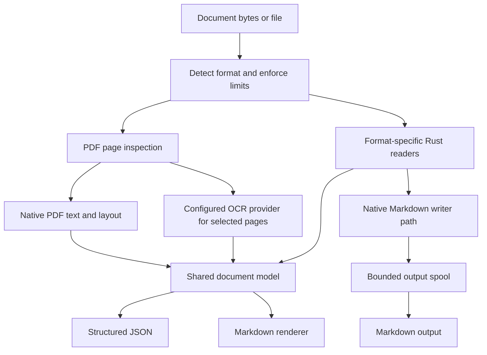

# BulkParse architecture

BulkParse separates document parsing, output rendering, OCR and process supervision. Format readers and the shared document model live in Rust. The CLI and language bindings expose that implementation without maintaining separate parsers.

## Workspace components

| Component | Responsibility |
| --- | --- |
| [`bulkparse`](../crates/bulkparse/src/lib.rs) | Format detection, readers, document model, PDF inspection, limits, diagnostics and Markdown rendering |
| [`bulkparse-cli`](../crates/bulkparse-cli/) | File and directory commands, output files and OCR configuration |
| [`bulkparse-ocr-native`](../crates/bulkparse-ocr-native/) | Native OCR orchestration, PDF rendering, image decoding, model-session reuse and scanned-table reconstruction |
| [`bulkparse-ocr`](../crates/bulkparse-ocr/) | Optional supervised process provider implementing the core OCR contract |
| [`bulkparse-pool`](../crates/bulkparse-pool/) | Optional bounded queue and persistent worker-process supervision |
| [`bindings/node`](../bindings/node/) | Node.js API through N-API |
| [`bindings/python`](../bindings/python/) | Python API through PyO3 |
| [`bindings/wasm`](../bindings/wasm/) | Byte-based browser/WASM API and supplied OCR evidence |

The portable core does not depend on the CLI, process pool or native inference runtime. Its default features enable PDF, DOCX and Office readers; Rust callers can select a smaller feature set.

## Parsing and output flow

Content signatures and package metadata guide detection; filenames or explicit format options resolve ambiguous inputs. Readers interpret each format's structure and produce common blocks, inline formatting, lists, tables and source locations. Package readers validate paths and enforce limits on expanded content. The [format contracts](office-formats.md) describe what each reader preserves and where fidelity is limited.

Structured parsing retains the document model in memory. The convenience APIs can return that model together with rendered Markdown, diagnostics and PDF inspection results. JSON Schema is generated from the Rust types; the language wrappers expose the same serialized result contract.

## Markdown writing and memory

The native [writer path](../crates/bulkparse/src/streaming.rs) avoids returning both a complete document model and a complete Markdown string when the caller only needs Markdown. CSV/TSV output releases records as they are processed. Spreadsheet readers release worksheets, and large worksheet XML uses bounded fragment storage. Other formats can still build a document model before rendering it.

Output first goes to a small memory spool that can spill to a temporary file. Parse errors, strict-mode rejection and recovery therefore do not publish stale output prefixes. Copying to an arbitrary caller-owned writer can still leave partial bytes if that final copy fails or is cancelled.

This is not constant-memory parsing: input bytes, an individual worksheet, structured API results, image assets and binding serialization can still require substantial memory. Complete in-memory JSON and streamed Markdown have different memory costs. Input, expanded data, page, node, cell and output limits remain explicit. Caller-supplied limits are honored; optional partial recovery reports incomplete coverage rather than silently claiming success.

## PDF inspection and OCR

PDF inspection exposes page-level routing information before OCR. Native text and layout are parsed by the core. When OCR is configured, selected pages are passed through the OCR provider contract and their evidence is incorporated into the common document model. See [PDF inspection](pdf-inspection.md) for routing and classification limits.

The native provider handles scanned PDFs and standalone images. Rust code coordinates rendering, recognition and table reconstruction using PDFium and ONNX Runtime with configured model files. Long-lived OCR parser instances reuse model sessions across documents. This path does not require a Python worker.

WASM shares the core's parsing and OCR-evidence validation, but does not load the native inference libraries. A browser host must supply OCR evidence through the supported API. OCR does not automatically describe pictures or infer formulas as LaTeX. Configuration, validation and remaining limitations are documented in [OCR bindings validation](ocr-bindings-validation.md).

## Bindings and execution

Node.js schedules native parsing through N-API asynchronous tasks. Python releases the GIL during native work. WASM exposes synchronous byte-based operations, which a browser application can run in a Web Worker; it does not expose filesystem APIs. Crossing a binding boundary and serializing results can allocate additional memory.

The CLI processes individual files or directories without starting a hidden process pool. Applications choose their own concurrency. The optional Rust [process pool](worker-pool.md) bounds queued and active work, reuses worker processes and enforces hard deadlines by terminating workers. A crashed or timed-out job is not automatically replayed. In-process cancellation remains cooperative.

Storage, authentication, durable queues, retries and deployment resource limits belong to the host application. BulkParse can run in server applications, command-line workflows or browser workers without a Bulkgrid account.

## Diagnostics and validation

Results carry status, coverage and diagnostics alongside extracted content. Diagnostic categories distinguish missing-content evidence, formatting limitations and informational notices. Markdown rendering can add its own diagnostics. A nonempty result or a `complete` status is not an independent guarantee of visual fidelity.

Rust tests cover format readers and parser behavior; binding checks compare serialized results across languages. Benchmark tooling is separate from the runtime. The [benchmark guide](../benchmarks/README.md) documents mixed-document coverage, PDF quality metrics, OCR measurements and before/after output, speed and memory checks. Performance claims belong with their measured workload and configuration, rather than in the architecture contract.
